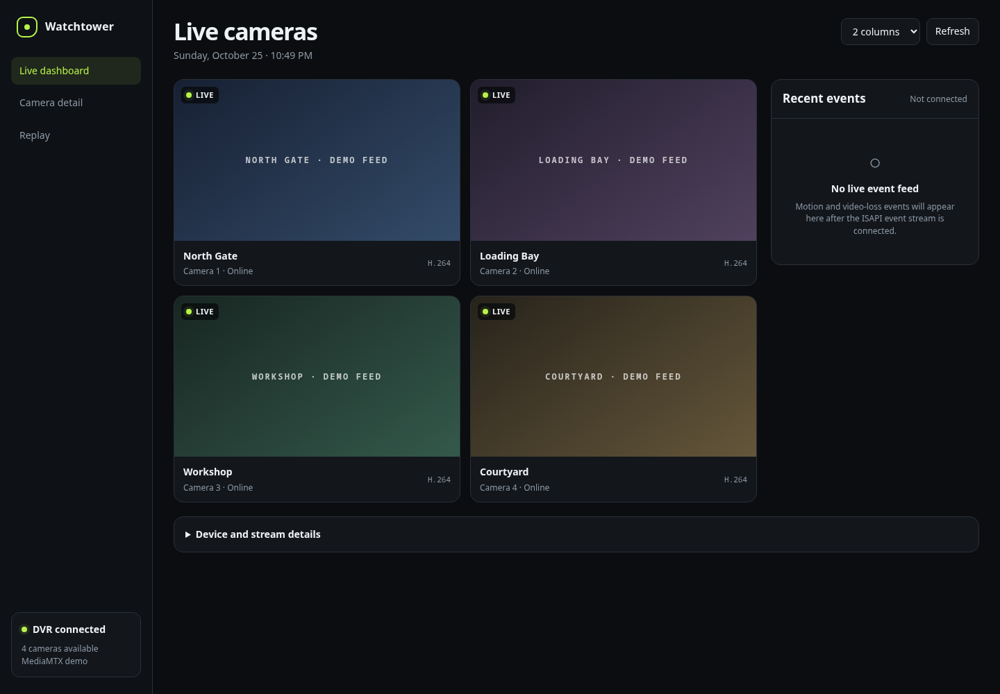

# Watchtower

Watchtower is a local web dashboard for Hikvision-compatible DVRs and cameras.
It reads device and channel details through ISAPI, registers enabled RTSP
streams with MediaMTX, and plays them in the browser over WebRTC.



## What works

- Live camera grid with two- and three-column layouts
- On-demand RTSP stream registration in MediaMTX
- Browser playback over WebRTC
- Camera snapshots and stream details
- Device, channel, and MediaMTX status
- Channel capability inspection

The recent-events and recording-replay screens are placeholders. They are not connected to the DVR yet.

## Requirements

- Go 1.27.1
- Node.js and npm
- [MediaMTX](https://github.com/bluenviron/mediamtx)
- A Hikvision-compatible device with ISAPI enabled

The machine running Watchtower must be able to reach the device and MediaMTX on
API port `9997` and WebRTC HTTP port `8889`. Browsers reach those WebRTC HTTP
endpoints through Watchtower's `/media/` proxy, but must still be able to reach
MediaMTX's advertised WebRTC media address.

## Setup

Install the frontend tools:

```sh
npm ci
```

Review `mediamtx.yml` before starting MediaMTX. Set `webrtcAdditionalHosts` to
the LAN address of the machine running MediaMTX. The included configuration uses
`192.168.68.104`. Change it if that address changes. The configuration is
intended for local development and allows anonymous media access, so change its
authentication settings before exposing it to another network.

Start MediaMTX with the project configuration:

```sh
mediamtx mediamtx.yml
```

In another terminal, start Watchtower with the device and MediaMTX credentials:

```sh
HOST_URL=http://dvr.local \
USER=admin \
PASSWORD=change-me \
MEDIAMTX_HOST=http://127.0.0.1:9997 \
MEDIAMTX_USER=user \
MEDIAMTX_PASSWORD=password \
make dev
```

Open <http://localhost:7331> on the same machine, or
<http://192.168.68.104:7331> from another device on the same network. Air
proxies the application through port `7331` during development and reloads it
when Go, templ, CSS, or JavaScript files change. Watchtower proxies browser
requests under `/media/` to MediaMTX port `8889`. Allow TCP port `7331` and UDP
port `8189` through the host firewall.

## Configuration

| Variable | Required | Description |
| --- | --- | --- |
| `HOST_URL` | Yes | Device origin, such as `http://dvr.local`. Do not include `/ISAPI` or credentials. |
| `USER` | Yes | Device username. |
| `PASSWORD` | Yes | Device password. |
| `MEDIAMTX_HOST` | Yes | MediaMTX API origin, usually `http://127.0.0.1:9997`. |
| `MEDIAMTX_USER` | Yes | MediaMTX API username. |
| `MEDIAMTX_PASSWORD` | Yes | MediaMTX API password. |
| `PORT` | No | Watchtower HTTP port. Defaults to `8080`. |

Watchtower adds one on-demand MediaMTX path per enabled channel, named
`channel-<channel ID>`. Existing paths with those names are left unchanged.

For a container deployment, use the MediaMTX service name for the private API:

```sh
MEDIAMTX_HOST=http://mediamtx:9997
```

Watchtower derives the internal WebRTC HTTP target as `http://mediamtx:8889`.
Publish Watchtower's HTTP port and MediaMTX's UDP port `8189`; the MediaMTX API
and HTTP port can remain on the container network. Set `webrtcAdditionalHosts`
to an address that browsers outside the container network can reach.

## Build and test

```sh
make build
make test
```

The production binary is written to `build/watchtower`. Run it with the same
environment variables shown above, then open port `8080` or the value set in
`PORT`.

Other useful commands:

```sh
make generate  # regenerate templ files
make css       # rebuild the Tailwind CSS bundle
make clean     # remove generated build output
```

## Security notes

- Keep Watchtower and the MediaMTX control API on a trusted network unless you
add access controls in front of them.
- Replace the development credentials in `mediamtx.yml` before deployment.
- Device credentials are placed in MediaMTX's in-memory RTSP path configuration
so MediaMTX can connect to the device.
- Do not put credentials in `HOST_URL` or `MEDIAMTX_HOST`.
